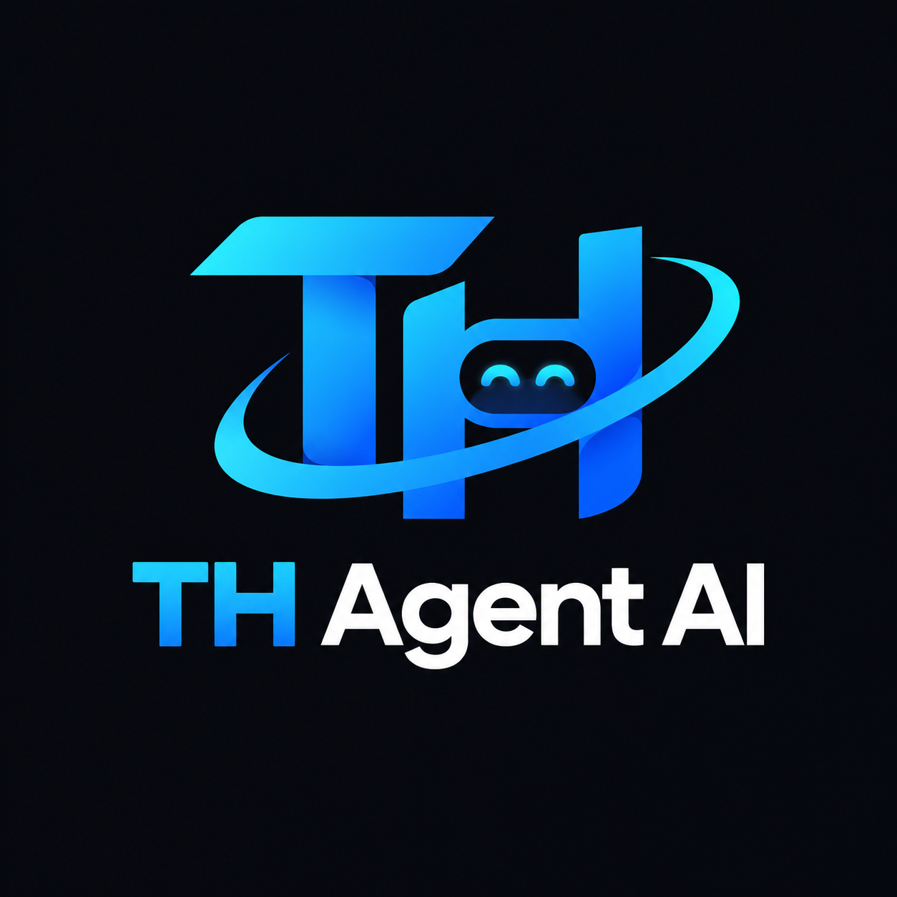

<p align="center">
  
</p>

<h1 align="center">⚡ TH Agent (Workspace Architecture)</h1>

<p align="center">
  <strong>Autonomous AI Coding Assistant, Multi-Project Orchestrator & Server DevOps</strong>
</p>

<p align="center">
  
  
  
</p>

---

## ⚡ Instalasi Cepat Sekali Jalan (Universal One-Line Installer)

Cukup salin dan jalankan satu baris perintah ini di terminal **macOS**, **Linux VPS / Server**, atau **Raspberry Pi**:

```bash
curl -fsSL https://raw.githubusercontent.com/taufik-hdyt25/AIAgent/main/install.sh | bash
```

Installer otomatis mendeteksi sistem operasi dan lingkungan kerja Anda:
- 🍏 **Di macOS (Local):** Otomatis membuat folder kerja `th-agent/`, mem-bundle bot ke direktori terisolasi `~/.th-agent/`, mendaftarkan background service macOS LaunchAgent 24/7 (anti-sleep `caffeinate -ims`), dan menjaga workspace `th-agent/projects/` **100% bersih tanpa `node_modules`**.
- 🐧 **Di Linux VPS / Server:** Mengonfigurasi container Docker (`docker compose up -d`) atau Native PM2 secara otomatis dengan port dan resource terisolasi.
- 🍓 **Di Raspberry Pi:** Menyiapkan konfigurasi ringan yang dioptimalkan untuk resource ARM.

---

## 🏗️ Struktur Arsitektur Workspace

Workspace **TH Agent** disusun secara bersih dan modular agar alur kerja (*flow*) koding, isolasi proyek, dan pengoperasian bot mudah dibaca:

```text
th-agent/
├── projects/                  # 📂 Workspace Folder Seluruh Proyek Koding Anda
│   └── ...                    #    (Otomatis terisolasi & bersih dari file engine bot)
│
└── telegram-ai-agent/         # 🤖 Core Aplikasi TH Agent (Bot & Control Panel)
    ├── src/                   #    Source code bot (handlers, services, config)
    ├── public/                #    Web Dashboard Control Panel (Port 3030)
    ├── data/                  #    Penyimpanan status proyek & context JSON
    ├── scripts/               #    Skrip utilitas & autostart (Mac / Pi / Linux)
    ├── Dockerfile             #    Spesifikasi container Docker (Node 26)
    ├── docker-compose.yml     #    Orkestrasi Docker standalone
    ├── package.json           #    Dependencies Node.js
    └── .env                   #    Konfigurasi environment & API keys
```

---

## 🛠️ Cara Menjalankan Manual (Alternatif)

Jika Anda sudah meng-clone repositori ini secara manual (`git clone https://github.com/taufik-hdyt25/AIAgent.git th-agent`):

### 1. 🌐 Di Linux VPS / Server (Docker Mode - Direkomendasikan)
Dari root workspace `th-agent/`:
```bash
docker compose up -d
```
Atau dari dalam folder bot `telegram-ai-agent/`:
```bash
cd telegram-ai-agent
docker compose up -d
```

### 2. 💻 Di Local Mac (Manual Isolated Setup)
Di Mac, jalankan skrip setup berikut dari root:
```bash
./setup-mac.sh
```
*(Untuk menghapus background service di Mac kapan saja: `./uninstall-mac.sh`)*

### 3. ⚙️ Mode Native Node.js (Dev / Debug)
```bash
cd telegram-ai-agent
npm install
npm start
```

---

## 🎛️ Layanan & Port Server
- **Web UI Control Panel:** `http://localhost:3030`
- **Telegram Bot:** Terhubung langsung ke bot Telegram via Webhook / Polling
- **Folder Kerja Koding:** Seluruh eksekusi AI terkunci di dalam `./projects/`

Dokumentasi teknis lengkap mengenai bot dapat dibaca di [telegram-ai-agent/README.md](./telegram-ai-agent/README.md).
